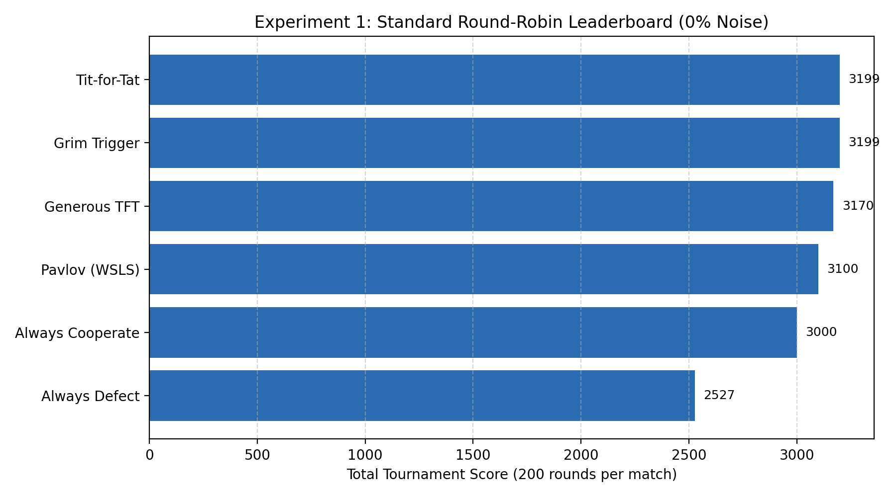
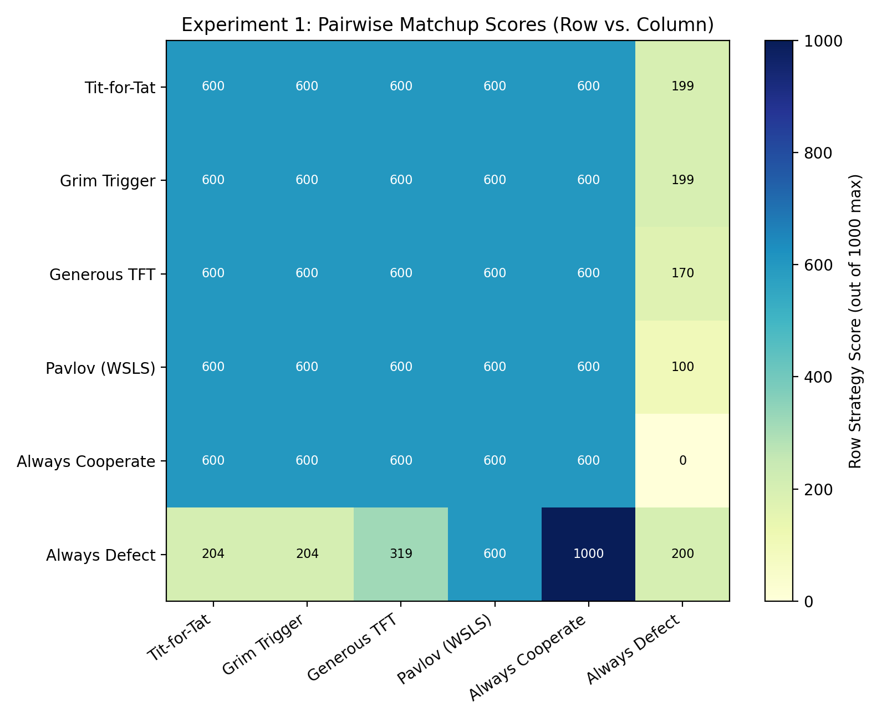
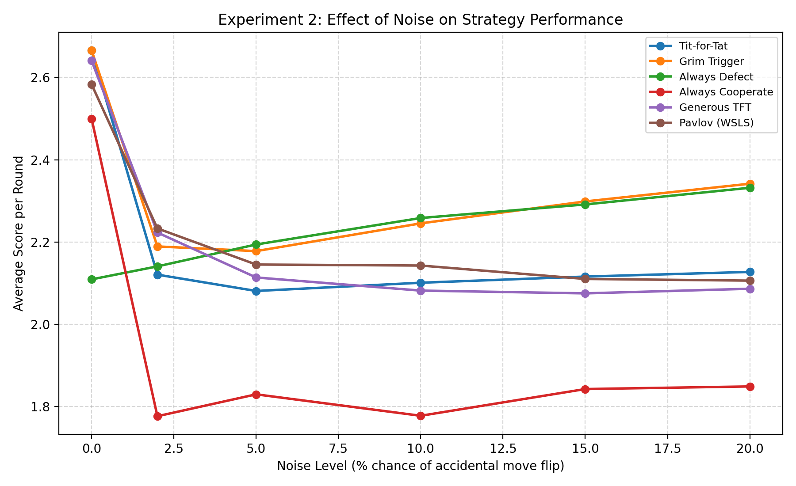
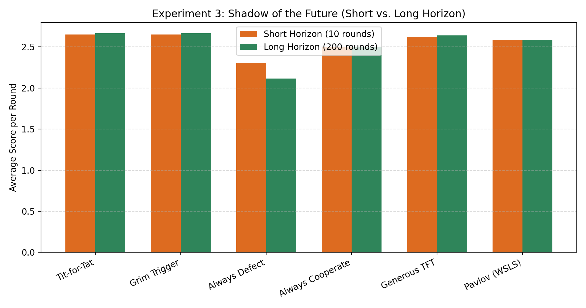

# Repeated Prisoner's Dilemma Tournament

A computational simulation of the Repeated Prisoner's Dilemma (inspired by Robert Axelrod's 1980 tournaments) comparing classic and forgiving strategies across clean, noisy, and varying-horizon environments.

## Payoff Matrix

| Player 1 \ Player 2 | Cooperate (C) | Defect (D) |
|---|---|---|
| **Cooperate (C)** | (3, 3) | (0, 5) |
| **Defect (D)** | (5, 0) | (1, 1) |

## Strategies Implemented

* **Tit-for-Tat:** Cooperates on round 1, then copies the opponent's previous move.
* **Grim Trigger:** Cooperates until the opponent defects once, then defects permanently.
* **Always Defect:** Always chooses Defect (`D`).
* **Always Cooperate:** Always chooses Cooperate (`C`).
* **Generous Tit-for-Tat:** Mirrors Tit-for-Tat but forgives an opponent's defection 15% of the time to break retaliation loops.
* **Pavlov (Win-Stay, Lose-Shift):** Repeats its last move after a good payoff (`3` or `5`) and switches after a bad payoff (`0` or `1`).

## Experiments

1. **Standard Round-Robin (200 rounds, 0% noise):** Evaluates overall tournament rankings and pairwise matchup scores.
2. **Noise Sensitivity (0%–20% flip probability):** Measures how accidental move errors impact strict vs. forgiving strategies.
3. **Horizon Comparison (10 vs. 200 rounds):** Demonstrates how the "shadow of the future" affects cooperative vs. exploitative play.

## Project Structure

```text
prisoners_dilemma_project/
├── strategies.py   # Strategy definitions
├── engine.py       # Payoff matrix, noise logic, and round-robin engine
├── experiments.py  # Experiment runner and matplotlib chart generation
└── outputs/        # Generated PNG visualizations


## Results

### 1. Standard Round-Robin Leaderboard (0% Noise)


### 2. Pairwise Matchup Heatmap


### 3. Noise Sensitivity (0%–20% Error Rate)


### 4. Short vs. Long Horizon (10 vs. 200 Rounds)
